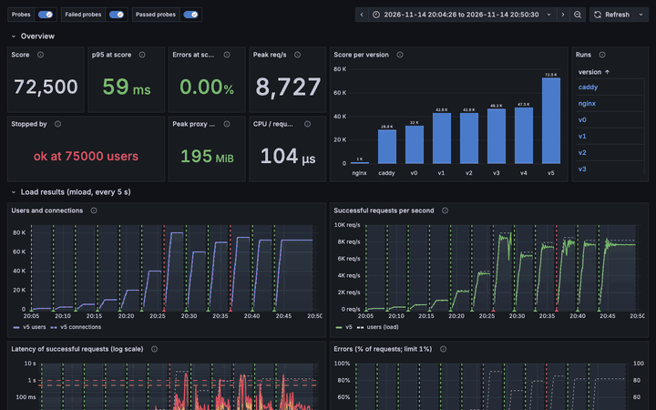
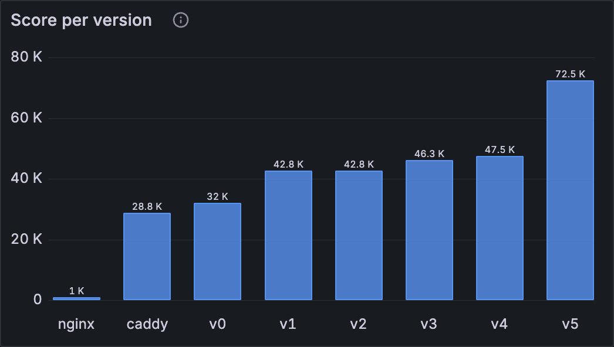

# reverse_proxy_max

[](https://github.com/artur-bertash/reverse_proxy_max/actions/workflows/proxy-ci.yml)
     

**[Live Grafana dashboard](https://web--grafana--8lskh6xd7t2n.code.run/d/proxy-capacity/proxy-capacity?from=2026-11-13T02:49:57.472Z&to=2026-11-13T03:32:26.873Z&timezone=browser&orgId=1)**



How many users can a reverse proxy written in Go handle on a 1 vCPU / 2 GB box, without breaking its SLIs + rules?

- real proxy: no caching, no merging requests, no doing the backend's job
- no kernel tuning, stock Ubuntu
- 1 vCPU Xeon 8260, 2 GB RAM
- p95 < 500 ms, p99 < 1 s, errors < 1%

**Answer: scroll to see my results ;)

## Results

<table><tr>
<td width="62%"></td>
<td>

| version | change |
|---|---|
| nginx | stock |
| caddy | stock |
| v0 | stock `ReverseProxy` |
| v1 | backend conn pool |
| v2 | `GOMEMLIMIT` (no gain) |
| v3 | `BufferPool` |
| v4 | own handler |
| **v5** | **own epoll server** |

</td>
</tr></table>

Code: [`proxies_tested/`](proxies_tested), current in [`proxy/`](proxy).

## Setup

| box | size | role |
|---|---|---|
| rp-loadgen | 4 vCPU, 6 GB | mload, Prometheus, Grafana (biggest: would bottleneck if weaker) |
| rp-backend | 2 vCPU, 3 GB | backend |
| rp-proxy | 1 vCPU, 2 GB | proxy |

- **Backend:** [c-iouring-pavlyhalim](https://github.com/arjaythedev/twelve-dollar-server-challenge/tree/main/submissions/c-iouring-pavlyhalim): simplest toolchain, low latency
- **Why not a fake backend:** this one is fast enough (~28k req/s), realistic, and checks correctness
- **Why a custom load generator, not k6:** k6 needs ~1–3 MB per user, so 100k users = 100–300 GB RAM

## How a run works

[`cmd/capacity`](cmd/capacity): doubling until a probe fails, binary search down to 5%, then a 5-minute hold. The hold is the score.

```sh
go run cmd/capacity/main.go -entry v5
cd results && docker compose up --build   # http://localhost:3000
```

Boxes: Ansible ([`infra/`](infra)). CI: the challenge's 42 tests through the proxy (42 again).

## Things I hit

- **nofile limit:** shell default is 1,024 fds, raised it
- **Port range:** Ubuntu gives ~28k, widened to 1024–65535 on the load generator
- **Fake wall at ~45k:** Linux's source port search ate the load generator's CPU past ~35k conns per address. Fix: extra IP on the proxy box
- **Memory:** v1 used ~33 KB per connection (goroutines, buffers, garbage). v5 idle connection: under 1 KB
- **pprof:** a new 32 KB buffer per request was 81% of allocations, GC took 27% of CPU. Fixed in v3

Inspired by the [$12 Server Challenge](https://github.com/arjaythedev/twelve-dollar-server-challenge) ([leaderboard](https://benchmarks.arjaythedev.com/12-dollar-server)): same VPS (1 vCPU Xeon 8260, 2 GB), load tool ([mload](https://github.com/arjaythedev/million-users-challenge/tree/main/bench/mload)) and seed (42, turns out it's the answer to everything), but a proxy instead of the app.
